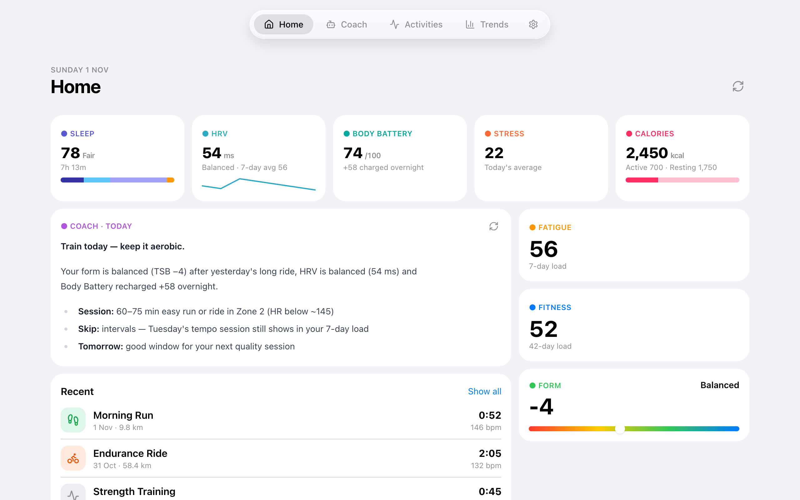
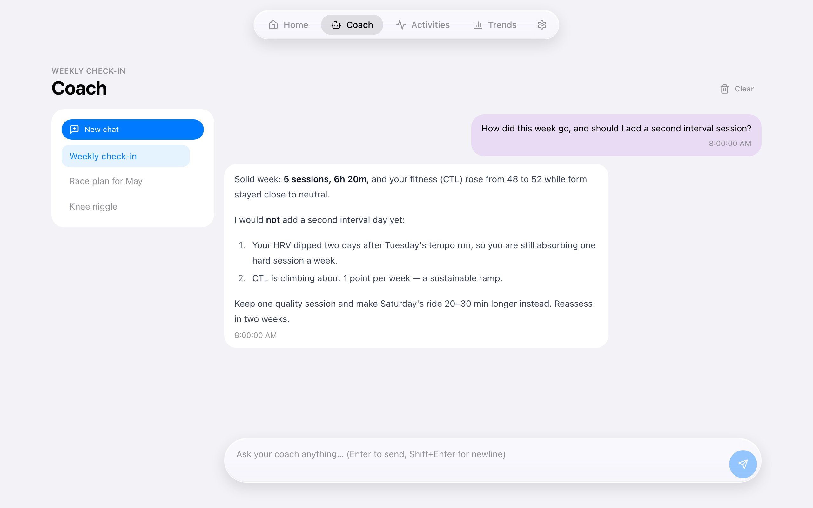
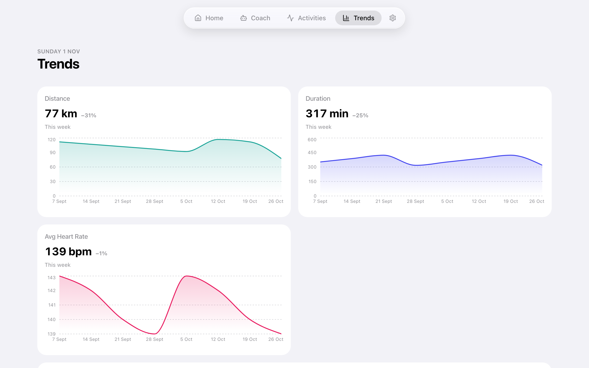
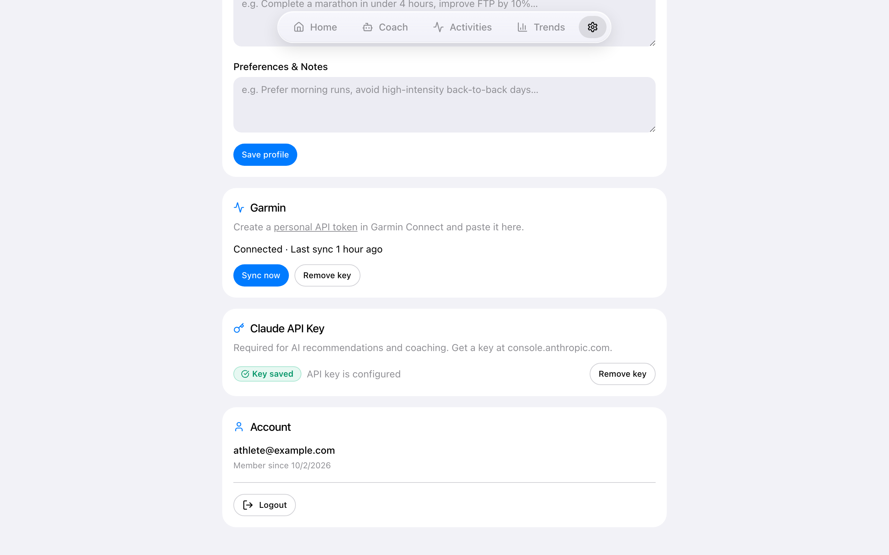

# FitCoach

[](https://sonarcloud.io/summary/new_code?id=ockiphertweck_FitCoach)
[](https://github.com/ockiphertweck/FitCoach/actions/workflows/test.yml)
[](https://github.com/ockiphertweck/FitCoach/actions/workflows/e2e.yml)

**Self-hosted AI training coach powered by Garmin and Claude.**

FitCoach connects to your Garmin account, computes training load metrics (ATL/CTL/TSB), and uses the Anthropic Claude API to deliver personalised coaching — a daily recap, an interactive chat, and weekly reports. Everything runs on your own hardware: your data is stored in your own database, and only the context needed for a coaching answer is sent to the Claude API (see [Data Privacy](#data-privacy)).

> A self-hosted alternative to TrainingPeaks AI features — no subscription, no vendor lock-in, bring your own Claude API key.

---

## Features

- **Daily recap** — a "train or rest today?" recap that loads automatically on the Home screen, streamed from Claude, and refreshes when your training data changes (new activity, profile edit)
- **AI Coach chat** — persistent multi-turn conversation with Claude, aware of your activity history and athlete profile
- **Weekly reports** — AI-generated summary with distance, duration, HR, ATL/CTL, and coaching notes
- **Trends** — interactive weekly trend charts for distance, duration, and heart rate
- **Training load** — ATL / CTL / TSB computed from TRIMP (same methodology as TrainingPeaks)
- **Garmin data source** — activities, sleep, HRV, Body Battery, stress and calories via the Garmin Personal API, pulled automatically when you open Home
- **Athlete profile** — weight, height, max HR, FTP, sex — passed to Claude for personalised advice
- **BYOK** — Claude API key stored AES-256-GCM encrypted; set it in Settings without redeploying
- **Appearance** — light, dark or system theme
- **Single-user** — first registered account locks the instance; designed for personal self-hosting

---

## Screenshots

| Home | Coach |
|---|---|
|  |  |

| Trends | Settings |
|---|---|
|  |  |

---

## Getting Started

**Prerequisites:** Git and Docker with Compose v2 for both options. For local development also Node.js ≥ 22 and pnpm ≥ 10 (`corepack enable` gives you the pinned pnpm version).

### 1. Clone and configure

```bash
git clone https://github.com/ockiphertweck/FitCoach.git
cd FitCoach
cp .env.example .env
```

Fill in three values in `.env` (everything else can stay as it is):

```bash
openssl rand -base64 32   # → JWT_SECRET
openssl rand -base64 32   # → API_KEY_ENCRYPTION_KEY
openssl rand -hex 16      # → DB_PASSWORD, and put the same value in place of "changeme" in DATABASE_URL
```

`DB_PASSWORD` is embedded in a URL, so stick to letters and digits. Postgres applies it only when its volume is first created; changing it later needs `docker compose down -v`, which wipes the data.

### 2a. Local development (hot reload)

```bash
docker compose up postgres -d    # Postgres on 127.0.0.1:5432
pnpm install
pnpm --filter api db:migrate
pnpm dev                         # API on :3000, frontend on :3001
```

`pnpm dev` builds `packages/shared` first, then starts both apps. If port 5432 is already used by another Postgres, stop that one or change the published port in `docker-compose.yml` and `DATABASE_URL`.

### 2b. Full Docker stack

```bash
docker compose up -d --build     # or ./setup.sh, which checks Docker and .env first
```

The API container applies pending database migrations on every start (`docker compose logs api` shows "Migrations applied"). Postgres is published on `127.0.0.1` only.

The browser calls the API at `NEXT_PUBLIC_API_URL`, which is **baked into the frontend at build time** and defaults to `http://localhost:3000`. To use FitCoach from another machine or under a domain, set `NEXT_PUBLIC_API_URL` (e.g. `https://fitcoach-api.example.com`) and `FRONTEND_URL` (e.g. `https://fitcoach.example.com`, used for CORS) in `.env`, then rebuild with `docker compose up -d --build`. The Docker API runs with `NODE_ENV=production`, so the session cookie is `Secure`: anything other than `localhost` must be served over HTTPS.

### 3. First run

1. Open **http://localhost:3001**. You are sent to **/setup** to create your account. The first account locks the instance: FitCoach is single-user and refuses further sign-ups.
2. **Settings → Claude API Key**: paste your Anthropic key (stored encrypted). Alternatively set `CLAUDE_API_KEY` in `.env` as an instance-wide fallback.
3. **Settings → Garmin**: connect your account (see [Connecting Garmin](#connecting-garmin)).
4. **Settings → Athlete Profile**: fill in weight, height, max HR, FTP and sex so Claude can personalise its advice.
5. Open **Home**: once the Garmin import has finished, the daily recap appears.

---

## Environment Variables

| Variable | Required | Description |
|---|---|---|
| `JWT_SECRET` | ✅ | JWT signing secret (≥ 32 chars) — `openssl rand -base64 32` |
| `API_KEY_ENCRYPTION_KEY` | ✅ | AES-256-GCM key (≥ 32 chars) — `openssl rand -base64 32` |
| `DB_PASSWORD` | ✅ | PostgreSQL password — letters and digits only, e.g. `openssl rand -hex 16` |
| `DATABASE_URL` | ✅ | Postgres connection string for `pnpm dev` / `db:migrate` on the host (`localhost:5432`). The Docker API container overrides it to reach the `postgres` service. |
| `CLAUDE_API_KEY` | optional | Instance-wide fallback Claude key; usually set in Settings instead |
| `POSTHOG_API_KEY` | optional | Usage analytics — disabled if omitted |
| `POSTHOG_HOST` | optional | Defaults to `https://eu.i.posthog.com` |
| `FRONTEND_URL` | optional | Frontend origin allowed by CORS — defaults to `http://localhost:3001` |
| `NEXT_PUBLIC_API_URL` | optional | API URL the browser calls, read when the frontend is **built** — defaults to `http://localhost:3000` |

The Garmin key is **not** an environment variable: you paste it in Settings (see below). `GARMIN_API_KEY` in `.env.example` is only read by the dev script `pnpm --filter api garmin:probe`, which prints Garmin response shapes.

---

## Connecting Garmin

1. Create a personal API key at [connect.garmin.com/app/settings/personalApiToken](https://connect.garmin.com/app/settings/personalApiToken)
2. Open FitCoach → **Settings** → **Garmin**, paste the key and click **Connect**. It is stored AES-256-GCM encrypted.
3. The first import pulls the last **12 months of activities** and **90 days of recovery data** (sleep, HRV, Body Battery, stress, calories). It runs in the background; Home shows "Importing from Garmin…" until it is done.

After that, data is pulled whenever you open Home (or return to the tab), **at most every 15 minutes**; **Sync now** forces it. When the key expires, Settings shows "Key invalid or expired" with a field to paste a new one — your data is kept and the reconnect runs a normal incremental sync, not a full re-import.

---

## Architecture

```
┌──────────────────────────────────────────────────────────────────────────┐
│                              docker compose                              │
│                                                                          │
│  ┌────────────────┐   HTTP/SSE   ┌─────────────────┐                    │
│  │   Frontend     │ ──────────▶  │      API         │  ┌─────────────┐  │
│  │  Next.js 15    │              │  Fastify v5      │  │ PostgreSQL  │  │
│  │  React 19      │ ◀── stream ─ │  Zod + Drizzle   │──│  pg16 +     │  │
│  │  port 3001     │              │  port 3000       │  │  pgvector   │  │
│  └────────────────┘              └────────┬─────────┘  └─────────────┘  │
│                                           │                              │
│                                ┌──────────┴──────────┐                  │
│                                ▼                     ▼                  │
│                       ┌──────────────┐     ┌──────────────┐            │
│                       │  Garmin API  │     │  Claude API  │            │
│                       │  Personal    │     │  (BYOK)      │            │
│                       │  API key     │     │  Streaming   │            │
│                       └──────────────┘     └──────────────┘            │
└──────────────────────────────────────────────────────────────────────────┘
```

**AI streaming request lifecycle:**

1. Browser `POST /ai/recommendation` (body `{ date }`) with session cookie
2. API verifies JWT, decrypts the user's Claude key (AES-256-GCM)
3. Queries Postgres for 42 days of activities, computes ATL/CTL/TSB, builds a structured prompt
4. Opens an Anthropic streaming request, forwards `data:` SSE chunks on the same HTTP response
5. Frontend reads via `ReadableStream`, appends each delta to React state → `react-markdown` renders live
6. After stream ends, the recap + token counts are stored in `daily_recommendations` (keyed by date and an input hash, so it is only regenerated when your data changes)

---

## Monorepo Structure

```
fitcoach/
├── apps/
│   ├── api/               # Fastify REST + SSE API
│   │   ├── src/
│   │   │   ├── db/        # Drizzle ORM client & schema
│   │   │   ├── middleware/ # JWT auth hook
│   │   │   ├── routes/    # activities · ai · auth · garmin · settings · wellness
│   │   │   └── services/  # atl-ctl · daily-recap · encryption · streams · wellness
│   │   │       └── garmin/ # client · sync · mappers · fit (FIT download)
│   │   └── drizzle/       # SQL migration files
│   └── frontend/          # Next.js 15 App Router
│       └── src/
│           ├── app/       # Route segments: activities · trends · coach · settings
│           ├── components/ # shadcn/ui primitives + shared Markdown renderer
│           └── lib/       # Typed API client + SSE streaming helper + Garmin auto-sync
├── packages/
│   └── shared/            # Zod schemas shared between API and frontend
├── db/
│   └── init.sql           # pgvector / pgcrypto bootstrap
└── docker-compose.yml
```

---

## Tech Stack & Key Design Decisions

### Fastify v5 + `fastify-type-provider-zod`

`fastify-type-provider-zod` bridges Fastify's validation pipeline with Zod — the same schema that defines TypeScript types also validates requests at runtime, with no duplication. Fastify v5 uses native async/await throughout and has measurably lower latency than Express.

### Drizzle ORM over Prisma

Drizzle is a pure query builder — zero runtime overhead, no code generation, no separate schema language. The schema in `apps/api/src/db/schema.ts` is the single source of truth; Drizzle Kit infers migrations from it. Result types are plain TypeScript objects.

### SSE over WebSockets for streaming

LLM output is unidirectional (server → client), which makes Server-Sent Events the right fit — no upgrade negotiation, works through most proxies, and the client is ~40 lines of `fetch` + `ReadableStream` with no dependencies. `X-Accel-Buffering: no` disables proxy buffering in production.

### JWT in HTTP-only cookie

- `httpOnly: true` — inaccessible to JavaScript; prevents XSS theft
- `secure: true` in production — HTTPS only
- `sameSite: "lax"` — blocks cross-site POST (CSRF protection)
- Verified with `jose` (ESM-native, no `node:crypto` shims needed)

### AES-256-GCM for credential storage

User-supplied API keys are encrypted before hitting the database. Each `encrypt()` call uses a fresh random 12-byte IV; the GCM auth tag rejects tampered ciphertexts at decryption. The encryption key never touches the database.

### pgvector included

The Postgres image includes `pgvector` for potential semantic search over activity data without a separate vector database.

### Biome over ESLint + Prettier

One Rust-based tool, one config file, zero conflicts between linter and formatter.

---

## Data Model

```
users              id, email, passwordHash, createdAt
apiKeys            userId → users, provider ("anthropic" | "garmin"), encryptedKey*  — UNIQUE(userId, provider)
garminSync         userId → users (PK), status, lastSyncedAt, lastError, keyExpiresAt, importedAt
dailyWellness      userId → users, date, sleep score/duration/stages, sleepStart/End, HRV,
                   Body Battery (overnight charge, at wake, current), stress, resting HR,
                   calories  — UNIQUE(userId, date)
userProfiles       userId → users (PK), sex, weightKg, heightCm, maxHeartRate, ftpWatts
activities         userId → users, externalId, source, sportType, startDate,
                   duration, distance, elevation, HR, pace, RPE, calories,
                   rawData (jsonb), streamData (jsonb, parsed FIT)  — UNIQUE(userId, externalId, source)
chatHistory        userId → users, role, content, tokensUsed, createdAt
dailyRecommendations userId → users, date, inputHash, content, tokensUsed, generatedAt  — UNIQUE(userId, date)
weeklyReports      userId → users, weekStart, summary, metrics (jsonb)  — UNIQUE(userId, weekStart)
```

`*` encrypted at rest with AES-256-GCM

**Notable choices:**
- `rawData jsonb` preserves the full source payload — new fields can be surfaced without a schema migration
- `UNIQUE(userId, externalId, source)` on activities enables safe upsert from repeated syncs
- `userProfiles` is a separate table (not columns on `users`) so it can be left entirely empty without nulls polluting the users row

---

## Training Science — ATL / CTL / TSB

FitCoach models training load using **TRIMP** (Training Impulse) — the same methodology behind TrainingPeaks.

**Session load:**
```
sessionLoad = durationHours × intensity
```
`intensity` priority: RPE (1–10) → avg heart rate ÷ 10 → 5 (default)

**ATL and CTL** are Exponentially Weighted Moving Averages walked day-by-day (so rest days correctly decay both values):

| Metric | Window | Alpha | Meaning |
|---|---|---|---|
| ATL — Acute Training Load | 7 days | 0.25 | Short-term fatigue |
| CTL — Chronic Training Load | 42 days | ≈ 0.046 | Long-term fitness |
| TSB — Training Stress Balance | CTL − ATL | — | Form / freshness |

TSB > +5 → fresh. TSB < −10 → accumulating fatigue.

---

## API Reference

All routes except `/auth/*` require a valid `fitcoach_token` cookie.

| Method | Path | Description |
|---|---|---|
| `GET` | `/auth/status` | First-run check — returns `{ setup: boolean }` |
| `POST` | `/auth/setup` | Create account + set session cookie |
| `POST` | `/auth/login` | Validate credentials + set session cookie |
| `POST` | `/auth/logout` | Clear session cookie |
| `GET` | `/auth/me` | Current user |
| `GET` | `/activities` | Paginated list — `limit`, `offset`, `sport`, `from`, `to` |
| `GET` | `/activities/stats` | Current `{ atl, ctl, tsb }` |
| `GET` | `/activities/:id` | Single activity |
| `GET` | `/wellness?date=` | Garmin recovery data — `{ today, days }` (last 7 days) |
| `GET` | `/ai/recommendation?date=` | Stored daily recap — returns `{ hasKey, recap }` (`recap` includes `stale`) |
| `POST` | `/ai/recommendation` | Stream daily recap (SSE) — body `{ date }` |
| `POST` | `/ai/chat` | Stream chat reply (SSE) |
| `GET` | `/ai/chat/history` | Chat history |
| `DELETE` | `/ai/chat/history` | Clear chat history |
| `POST` | `/ai/weekly-report` | Generate / return this week's report |
| `POST` | `/garmin/connect` | Validate + store Garmin Personal API key, start initial import |
| `GET` | `/garmin/status` | `{ connected, status, lastSyncedAt, lastError, keyExpiresAt }` |
| `POST` | `/garmin/sync` | Incremental sync (15 min gate; body `{ force }`) |
| `DELETE` | `/garmin/key` | Remove Garmin key + sync state (data kept) |
| `GET` | `/settings/apikey` | Configured providers |
| `POST` | `/settings/apikey` | Save encrypted API key |
| `DELETE` | `/settings/apikey/:provider` | Remove API key |
| `GET` | `/settings/profile` | Athlete profile |
| `PUT` | `/settings/profile` | Update athlete profile |

---

## Development

```bash
# Start only the database
docker compose up postgres -d

# API (hot reload) + frontend (hot reload)
pnpm dev

# Full Docker stack
docker compose up -d --build
```

**Other tools:**

```bash
pnpm --filter api db:generate   # generate migration after schema change
pnpm --filter api db:migrate    # apply pending migrations
pnpm --filter api db:studio     # Drizzle Studio — visual DB browser (localhost:4983)
pnpm --filter api test          # run unit tests
pnpm --filter api test:coverage # coverage report → apps/api/coverage/index.html
```

---

## Data Privacy

FitCoach is **fully self-hosted** — all activity data, wellness data, chat history, and credentials live in your local PostgreSQL database. The only external calls are:

- **Anthropic Claude API** — recent activities, sleep, HRV, Body Battery, stress and resting heart rate, plus chat messages, are sent to generate coaching responses. [Anthropic privacy policy](https://www.anthropic.com/privacy).
- **Garmin** — the data source: activities and daily wellness are fetched and stored locally.
- **PostHog** (optional) — usage analytics and LLM metrics only. Privacy mode is forced on every Claude call, so PostHog receives no prompt or response content. EU instance by default.

**To delete all data:** `docker compose down -v`

---

## Contributing

Issues and PRs are welcome. Please open an issue before starting significant work.

---

## License

MIT — see [LICENSE](LICENSE)
